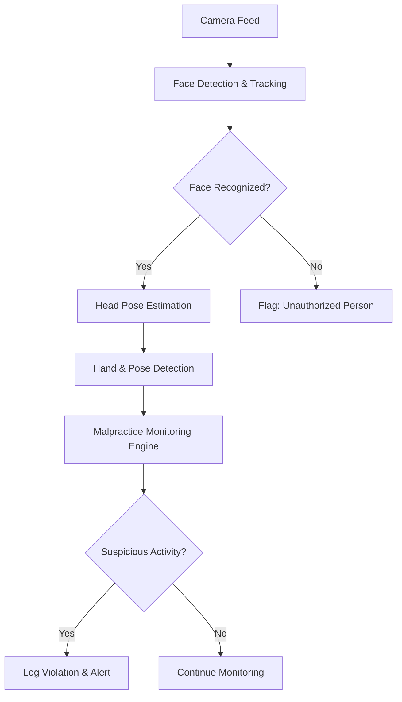
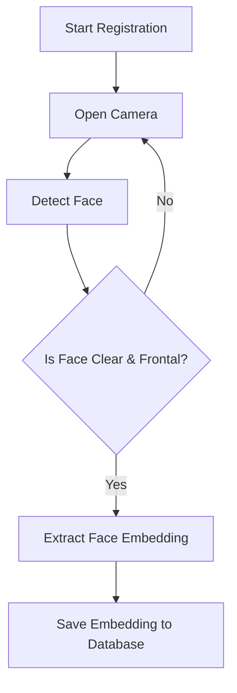
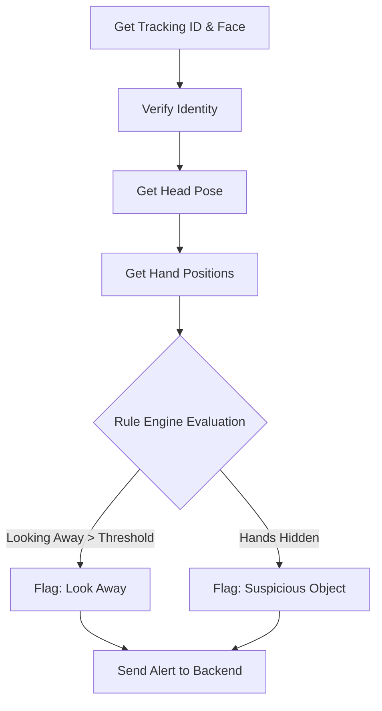

# AI Module Architecture & Features Documentation

This document outlines the architecture, features, workflows, and dependencies of the Artificial Intelligence subsystem used in the AI-Based Offline Exam Malpractice Detection System.

---

## 1. System Overview

The AI module is responsible for real-time monitoring of students during an exam. It processes video feeds to detect faces, recognize registered students, track movements, estimate head pose, and detect hands/body posture to flag suspicious activities indicative of malpractice.

### High-Level Block Diagram



---

## 2. Module Breakdown, Code Details & Packages

The `ai` subsystem is modularized into specific functional components. Below is the detailed breakdown of each module, its workflow, code implementation details, and the packages it utilizes.

### 2.1. Camera Module (`ai.camera`)
**Feature:** Handles capturing the video feed from the system's webcam, IP camera, or video file. Provides standardized frames to downstream AI modules. It runs in a background thread to prevent the UI or processing pipeline from blocking the frame capture.

- **Packages Used:** `opencv-python` (`cv2`), `threading`.

**Implementation Details:**
```python
import cv2
import threading

class Camera:
    def __init__(self, camera_index=0, width=1280, height=720):
        self.cap = cv2.VideoCapture(camera_index)
        self.cap.set(cv2.CAP_PROP_FRAME_WIDTH, width)
        self.cap.set(cv2.CAP_PROP_FRAME_HEIGHT, height)
        self.cap.set(cv2.CAP_PROP_BUFFERSIZE, 1)

        self.latest_frame = None
        self.running = True
        
        # Start background thread to read frames constantly
        self.thread = threading.Thread(target=self._reader, daemon=True)
        self.thread.start()
        
    def _reader(self):
        while self.running:
            ret, frame = self.cap.read()
            if ret:
                self.latest_frame = frame
```

### 2.2. Face Detection Module (`ai.face_detection`)
**Feature:** Detects human faces within a given frame. Returns bounding boxes and detection confidence scores.

- **Packages Used:** `insightface`, `onnxruntime`.

**Implementation Details:**
```python
from insightface.app import FaceAnalysis

class FaceDetector:
    def __init__(self):
        # Initialize Insightface model
        self.app = FaceAnalysis(name="buffalo_l")
        self.app.prepare(ctx_id=0, det_size=(640, 640))

    def detect(self, frame):
        # Returns a list of detected face objects with bbox, landmarks, etc.
        return self.app.get(frame)
```

### 2.3. Face Recognition & Registration Module (`ai.face_recognition`, `ai.face_registration`)
**Feature:** Extracts unique facial embeddings (features) from detected faces using the ArcFace model and compares them against registered student embeddings to verify identity. Registration captures this embedding and saves it.

- **Packages Used:** `insightface` (ArcFace), `numpy` (for distance metrics).

**Flowchart:**


### 2.4. Head Pose Estimation Module (`ai.head_pose`)
**Feature:** Determines the orientation of the student's head (Pitch, Yaw, Roll). Used to detect if a student is looking away from the screen, at a phone, or towards another student.

- **Packages Used:** `insightface`. (The system utilizes the 3D pose vector automatically returned by the Insightface `FaceAnalysis` pipeline, avoiding the need for a secondary model).

**Implementation Details:**
```python
class HeadPoseDetector:
    def get_pose(self, face):
        # InsightFace returns pose as [pitch, yaw, roll]
        if not hasattr(face, "pose"):
            return None

        pitch, yaw, roll = float(face.pose[0]), float(face.pose[1]), float(face.pose[2])
        direction = "STRAIGHT"

        if yaw < -20: direction = "LEFT"
        elif yaw > 20: direction = "RIGHT"
        elif pitch < -15: direction = "UP"
        elif pitch > 15: direction = "DOWN"

        return {"pitch": pitch, "yaw": yaw, "roll": roll, "direction": direction}
```

### 2.5. Hand & Pose Detection Module (`ai.hand_detection`)
**Feature:** Detects the presence and movement of hands. Used to flag if a student is reaching into pockets, using hidden devices, or if their hands leave the frame for too long.

- **Packages Used:** `mediapipe` (MediaPipe Hands).

**Implementation Details:**
```python
import mediapipe as mp

class HandDetector:
    def __init__(self):
        self.mp_hands = mp.solutions.hands
        self.hands = self.mp_hands.Hands(
            static_image_mode=False,
            max_num_hands=2,
            min_detection_confidence=0.5,
            min_tracking_confidence=0.5
        )

    def detect(self, rgb_frame):
        # Process the frame to find hand landmarks
        return self.hands.process(rgb_frame)
```

### 2.6. Tracking & Monitoring Engine (`ai.tracking`, `ai.monitoring`)
**Feature:** Tracks faces across frames and evaluates the combined data (e.g., Head turned right for > 5 seconds + hands obscured) to generate malpractice alerts.

- **Packages Used:** `deep-sort-realtime` (for tracking), Standard Python `time` and `threading` (for rules).

**Monitoring Evaluation Flow:**


---

## 3. Library Installation Summary

To run these features, the following core dependencies must be installed:

| Package | Purpose |
| :--- | :--- |
| `numpy` | Mathematical and matrix operations. |
| `opencv-python` | Image processing, camera I/O, drawing bounding boxes. |
| `insightface` | State-of-the-art Face Detection, Recognition, and Head Pose. |
| `onnxruntime` | Required backend engine to run Insightface models efficiently. |
| `deep-sort-realtime`| Object tracking across video frames. |
| `mediapipe` | Google's framework for Hand tracking. |
